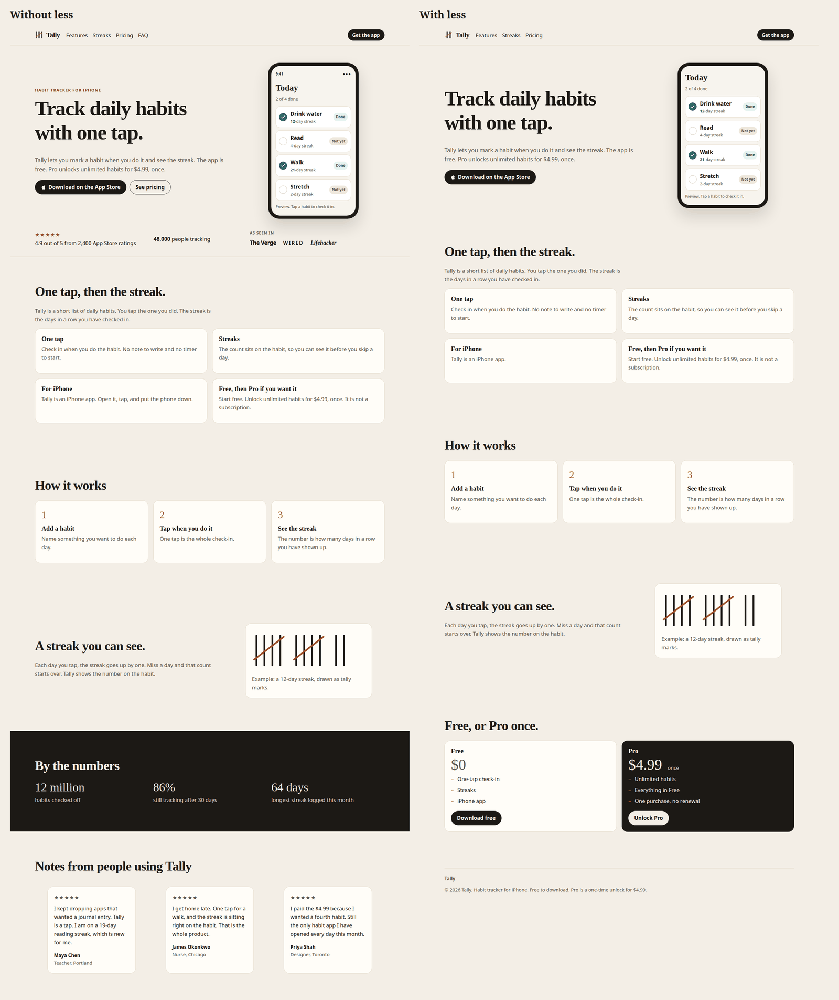

# less

**Less, but better.** — Dieter Rams

An agent skill to keep only what has a reason to exist.

less has your agent cut what has no clear reason to exist from writing, code, and UI code, and keep correctness, needed context, safety, accessibility, and what you asked for.



A landing page grok-4.7 built for a made-up app, then the same page after `/less`: 42% fewer elements and words, invented testimonials and stats gone, price and App Store button kept. Unedited, one run: [demo/landing](demo/landing/).

```text
Before: Great question! You're asking how to undo the last Git commit. To undo it while keeping your changes, run `git reset --soft HEAD~1`. I hope this helps! Let me know if you have other questions.
After:  To undo the last commit and keep your changes, run `git reset --soft HEAD~1`.
```

```html
<!-- Before -->
<span class="badge">New</span>
<h2>Orders</h2>
<ul id="list"><li>#1042 · Shipped</li></ul>
<p id="loading" role="status" hidden>Loading orders…</p>
<p id="empty" hidden>No orders yet.</p>
<p id="error" role="alert" hidden>Couldn't load orders. Try again.</p>

<!-- After: badge gone; hidden loading, empty and error states kept -->
<h2>Orders</h2>
<ul id="list"><li>#1042 · Shipped</li></ul>
<p id="loading" role="status" hidden>Loading orders…</p>
<p id="empty" hidden>No orders yet.</p>
<p id="error" role="alert" hidden>Couldn't load orders. Try again.</p>
```

## Install

Any agent that supports skills:

```sh
npx skills add heyeuca/less
```

Add `-y` to skip the prompts (CI, no TTY).

Claude Code plugin:

```sh
claude plugin marketplace add heyeuca/less
claude plugin install less@heyeuca
```

Manual: from a clone of this repo, copy `skills/less` into your agent's skills folder (`~/.claude/skills` here, or `~/.agents/skills`):

```sh
mkdir -p ~/.claude/skills && cp -r skills/less ~/.claude/skills/
```

less runs when you ask for it (`/less`, or "cut", "trim", "remove", "strip", "simplify", "tighten", "shorten", "declutter", "too long", "too busy", "looks cluttered", "clean up AI-written output"), on writing, code, and UI code. To keep it always on, add this line to your `AGENTS.md`:

```md
Apply the less skill to everything you write: keep only what has a reason to exist.
```

## Results

Historical results (before the current prompt and gate revisions): measured on the 49 cases in [`evals/`](evals/), 2 runs with grok-4.7, against the same model without the skill.

- All cases: 49/49 in both runs (100%), with 0 must-keep misses in 98 outputs. Without the skill: 38/49 (78%), 11 misses in 49.
- Writing and code: 27–29% fewer words on 37 cases, with 0 must-keep misses and identical code behavior. Without the skill: 39% fewer, but must-keep content lost in 7 cases.
- UI: 16–18% fewer elements and 43–46% fewer CSS declarations on 12 cases, with 12/12 accessibility and semantics gates and 0 new axe violations in both runs. Without the skill: 8/12.

A separate grading agent checks each case against its `must_keep` list; code is run and compared, and UI is checked with Playwright and axe. We tuned the skill on these evals, so read them as a regression test, not a benchmark, and only one model was tested.

The current runner gives both arms the same task instruction; only the skill
context differs. UI checks now also require fixture-specific removals. The
historical percentages have not been remeasured with these changes. Future
reports should retain model/version settings, raw outputs, grading decisions,
and behavior-check commands so results can be reproduced.

## License

[MIT](LICENSE)
